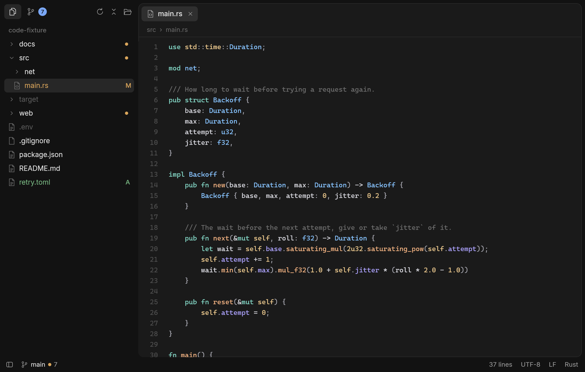
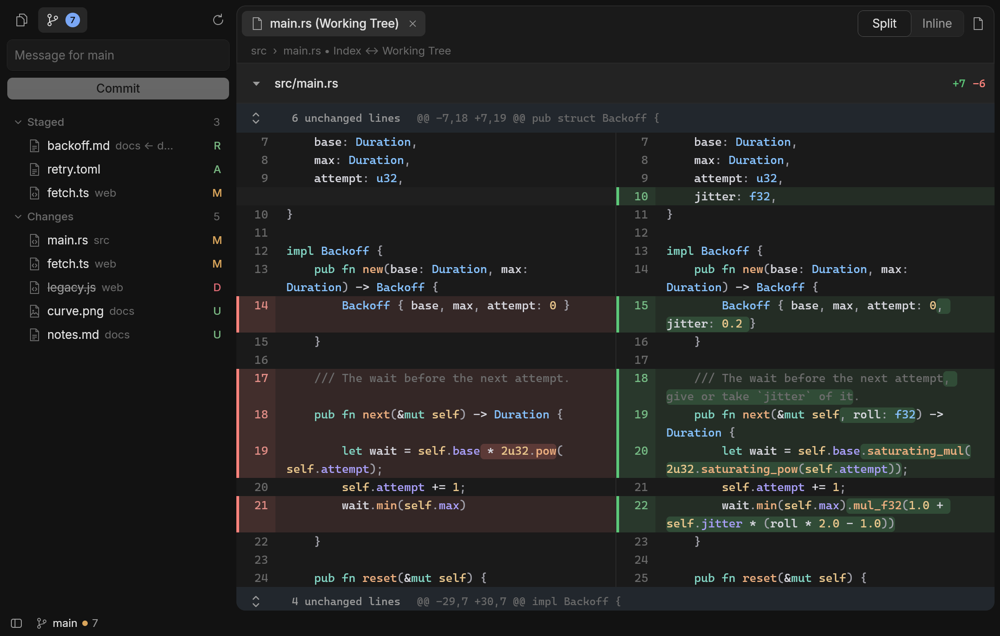

# code

A basic code editor written in Rust on [Rune](https://github.com/anomalyco/rune), a native
GPU-rendered UI framework. It opens a folder, lists its files beside the code, and shows git's
changes and their diffs.





## What it does

- **Workspace**: open a folder from the side bar, with `Ctrl+O`, or as `code FOLDER`. The last
  folder opens again on the next start.
- **Explorer**: the folder as a tree, folders first. Changed files carry git's colour and
  letter, and folders with changes inside a dot. Ignored folders (`target`, `node_modules`) are
  listed only when you open them.
- **Code**: syntax colours for about 80 languages, line numbers, tabs with previews (a single
  click previews, a double click keeps the tab), and text you can select and copy. Files are
  read-only: there is no editing or saving.
- **Source control**: staged and unstaged changes, stage and unstage (one file or all), a
  commit message box and Commit (`Ctrl+Enter`), and Initialize Repository for a folder without
  one.
- **Diffs**: click a change to compare the working tree with the index, or the index with
  `HEAD` for a staged change. Split or inline, with word-level changes and folded unchanged
  lines that expand.
- **Live**: the folder is watched, so files and git state changed by other programs show up
  on their own.

| Keys | |
| --- | --- |
| `Ctrl+O` | Open a folder |
| `Ctrl+Shift+E` / `Ctrl+Shift+G` | Explorer / Source Control |
| `Ctrl+B` | Toggle the side bar |
| `Ctrl+Tab` / `Ctrl+Shift+Tab` | Next / previous tab |
| `Ctrl+W` | Close the tab |
| `j` / `k` | Next / previous change in a diff |

On macOS the primary modifier is `Cmd`.

## Run

```sh
cargo run --release                  # the folder opened last time
cargo run --release -- path/to/folder
```

It needs a recent Rust toolchain (built and tested with 1.100 on Windows; Rune itself pins
1.99) and `git` on the `PATH`. The first build compiles Rune and takes a few minutes. Rune's
README lists what Linux needs (`libxkbcommon-dev` and `libwayland-dev` to build).

Settings (the last folder, the side bar's width, the diff layout) are kept in `prefs.json`
under the platform's config folder for `code-editor-rune`, which on Windows is
`%APPDATA%\code-editor-rune`. That is deliberately not `%APPDATA%\Code`, Visual Studio Code's.

## Develop

```sh
cargo test                           # unit tests, and the window driven headlessly
cargo clippy --all-targets
cargo fmt
```

The tests in `src/ui/tests.rs` build real folders and git repositories under the system's
temporary folder and click through the window with Rune's headless runtime.

Rune apps render without a window, which is how the stills above are made:

```sh
scripts/fixture.sh /tmp/code-fixture   # a repository with a change of every kind
CODE_SCENE_FILE=src/main.rs cargo run -- /tmp/code-fixture --scene file --snap docs/file.png --size 1100x700 --scale 2
cargo run -- /tmp/code-fixture --scene diff --snap docs/diff.png --size 1100x700 --scale 2
```

Scenes are `file`, `scm`, `diff`, `diff-inline` and `staged`; `--theme light` renders the
light appearance, which the window otherwise takes from the system.

### Performance

The window's thread only draws. Listing the folder, git, reading and colouring files run on
workers, which also build what the window will show (the explorer's tree, a file's lines). A
scan that finds the folder, the repository and the open file as they were changes nothing and
draws nothing. Lists build only the rows on screen, and content is put in place rather than
animated in.

```sh
cargo test --release perf -- --ignored --nocapture --test-threads=1   # timings, printed
scripts/launch-time.sh /tmp/code-fixture                               # ms to the first frame
RUNE_COMMIT_BUDGET_MS=8 cargo run --release -- path/to/folder         # names slow frames
```

The first is `src/perf.rs`: a 20,000-file repository and a 50,000-line file, timing a rescan's
worker and window-thread halves and the frames that follow a click.

| File | |
| --- | --- |
| `src/main.rs` | The window's spec, command line and scenes |
| `src/app.rs` | State: the workspace, tabs, background jobs, the file watcher |
| `src/git.rs` | Git through its command line: status, file contents, stage, commit |
| `src/workspace.rs` | Listing a folder and reading files |
| `src/doc.rs` | A file as lines with their syntax colours |
| `src/jobs.rs` | Work on worker threads, answered through a queue |
| `src/perf.rs` | Benchmarks (ignored tests) |
| `src/theme.rs` | Colours and type |
| `src/ui/` | The view: side bar, editor, status bar |

Rune is pre-release, so `Cargo.toml` pins one revision of it, and repeats Rune's own
`[patch.crates-io]` entries at that revision as Rune's README asks. To update, change every
`rev` together.
